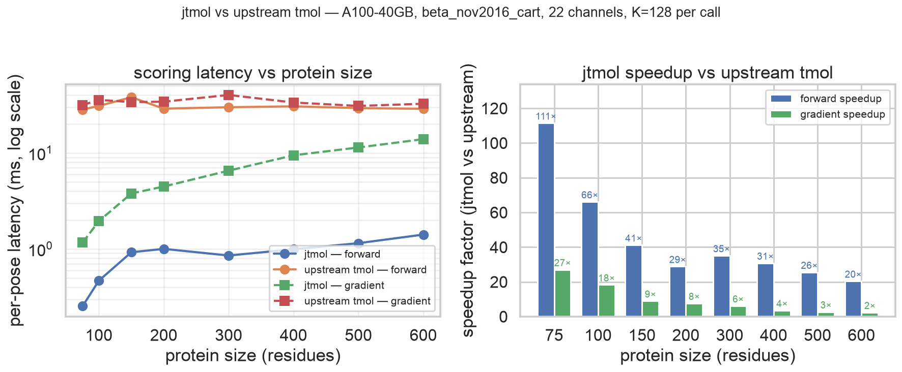

# jtmol

A pure-JAX port of [tmol](https://github.com/uw-ipd/tmol), the
GPU-accelerated reimplementation of Rosetta's `beta_nov2016_cart`
energy function from the Baker Lab. Upstream is PyTorch with
hand-written C++/CUDA kernels; jtmol replaces both with `jit`, `vmap`,
`lax.scan`, and `jax.grad` over pure Python.

The port makes Rosetta scoring composable with the rest of the JAX ML
stack (Boltz-2, mosaic, AlphaFold, ESM, etc.) so Rosetta energies can
act as a differentiable loss in protein design loops without the
autograd-boundary friction of going through torch. The integration
with mosaic binder hallucination is described in
[`docs/MOSAIC_INTEGRATION.md`](docs/MOSAIC_INTEGRATION.md).

The Python import path is `tmol_jax` (kept for parity with upstream);
the project name is **jtmol**.

```python
import tmol_jax

ps   = tmol_jax.pose_stack_from_pdb("1ubq.pdb")
sfxn = tmol_jax.beta2016_score_function()

E    = sfxn(ps)                              # [n_poses]
ps_m = tmol_jax.run_cart_min(ps, sfxn)       # L-BFGS Cartesian minimize
g    = jax.grad(lambda c: sfxn(ps.replace(coords=c)).sum())(ps.coords)
```

## Install

With [uv](https://docs.astral.sh/uv/) (recommended):

```bash
git clone https://github.com/tudorcotet/jtmol
cd jtmol
uv pip install -e .
```

Or pip:

```bash
pip install -e .
```

Requires Python ≥ 3.10 and JAX ≥ 0.4.30. PyTorch is not needed at
runtime, only optionally for regenerating binary scoring tables via
`scripts/convert_binary_tables.py`.

For protein-ligand support (loading complexes with small-molecule
ligands), install the optional `ligand` extra, which pulls in RDKit:

```bash
uv pip install -e '.[ligand]'
```

See [Protein-ligand status](#protein-ligand-status) for what this
currently covers.

## Benchmarks

Head-to-head against the upstream `tmol-0.1.22+cu128torch2.10` wheel on
a single A100-40GB. Both backends evaluate the full
`beta_nov2016_cart` (22 channels) on the same protein. K=128 perturbed
poses per call. jtmol uses `jax.lax.map`-chunked vmap with `chunk_size`
adapted to N, and the neighbor-list path on LJLK, elec, and lk_ball.
Upstream is the live PyTorch wheel doing K serial scorings.



| Protein size | jtmol forward (ms/pose) | upstream forward | speedup | jtmol gradient | upstream gradient | speedup |
|---:|---:|---:|---:|---:|---:|---:|
| 75 res | 0.25 | 28.3 | **111×** | 1.17 | 31.5 | **27×** |
| 200 res | 1.00 | 28.9 | 29× | 4.47 | 34.2 | 7.6× |
| 600 res | 1.41 | 28.8 | **20×** | 13.9 | 32.5 | **2.3×** |

Two structural reasons for the gap:

1. **One XLA kernel per call**, not ~200. `jax.jit` fuses all 22
   channels into a single launch. Upstream evaluates each channel as a
   separate PyTorch op; per-call dispatch overhead dominates compute
   for every protein size in the sweep, which is why upstream stays at
   ~30 ms regardless of N.
2. **Pair work is O(N · k_max)**, not O(N²). Each big pair term
   (LJLK, elec, lk_ball) has its own cell list, opt in via
   `beta2016_score_function(use_neighbor_list=True)`. Bit-identical on
   1ubq to the dense path.

Full methodology, dispatch-vs-compute analysis, and parity caveats:
[`docs/EXPERIMENT_LOG.md`](docs/EXPERIMENT_LOG.md). Per-run raw
numbers: [`docs/BENCHMARKS.md`](docs/BENCHMARKS.md).

## Parity

On 1ubq, forward energies match upstream's per-term goldens across all
20 score channels of `beta_nov2016_cart`, and `jax.grad` matches
central finite-difference of upstream's own forward to ~1e-9 in
float64. The single-chain multi-PDB panel (1qys, 1r21, 3plc, 6DMZ_A)
matches upstream on most channels with small drifts on the rotamer
library terms (`dunbrack_rotdev` / `dunbrack_semirot`, where jtmol
uses bilinear interpolation vs upstream's bicubic B-spline). Multi-
chain interface PDBs (1CGI, 1PRG, 7OPB) currently concatenate chains
into a single PoseStack rather than detecting the inter-chain break,
so inter-chain totals diverge from upstream there: a known gap,
tracked in [`docs/MULTI_CHAIN_PARITY.md`](docs/MULTI_CHAIN_PARITY.md).
The per-term table and full caveats live in
[`docs/PARITY.md`](docs/PARITY.md).

One channel worth flagging: upstream's hand-written CUDA adjoint for
`lk_bridge_uncpl` disagrees with finite-difference of its own forward
at sp2 backbone-O acceptors, by up to 0.16 kcal/mol/Å on the carbonyl
O atoms of GLN-1 and GLN-61 on 1ubq. jtmol's `jax.grad` matches FD to
1e-9 there. Reproducer and analysis in
[`docs/UPSTREAM_BUG_LK_BRIDGE_UNCPL.md`](docs/UPSTREAM_BUG_LK_BRIDGE_UNCPL.md).

That is the first of six upstream bugs catalogued while building
jtmol. The full list is in [`docs/UPSTREAM_BUGS.md`](docs/UPSTREAM_BUGS.md)
with reproducers and workarounds; each one drives a category of
"expected mismatch" cell in the parity matrix at
[`docs/UPSTREAM_PARITY.md`](docs/UPSTREAM_PARITY.md).

## What's in the package

| Module | What it does |
|---|---|
| `tmol_jax.pose` | `Pose`, `PoseStack`, `PackedBlockTypes` as JAX pytrees |
| `tmol_jax.chemical` | `ChemicalDatabase` from upstream YAMLs verbatim |
| `tmol_jax.kinematics` | `KinForest` + `forward_kin` / `inverse_kin` via `lax.scan` |
| `tmol_jax.score` | All 20 channels of `beta_nov2016_cart` |
| `tmol_jax.optimization` | L-BFGS, Cartesian and kinematic |
| `tmol_jax.pack` | Rotamer packer (Metropolis-MC over jitted score) |
| `tmol_jax.relax` | FastRelax |
| `tmol_jax.io` | PDB read/write, canonical ordering, biotite + ligand pose construction |
| `tmol_jax.ligand` | Ligand params-file (`.tmol`) parsing (optional `ligand` extra) |
| `examples/integration_mosaic_hallucinator.py` | `LossTerm` wrappers for [mosaic](https://github.com/escalante-bio/mosaic) / Boltz-2 hallucination |

## Protein-ligand status

jtmol can load a protein-ligand complex and place the ligand in the
`PoseStack` given a precomputed upstream `.tmol` params file, and score
the ligand's Lennard-Jones / Lennard-Kihara contributions. Verified on
the cdk2 complex (280 residues): the ligand block is constructed with
its 28 atoms at crystal coordinates, all atom types resolve to
generic-potential LJ/LK parameters, and protein-only parity is
unchanged (panel snapshot passes).

What works:

- `pose_stack_from_biotite(atoms, ligand_params_files=[...])` builds a
  `PoseStack` containing the ligand residue.
- Generic-potential ligand atom types (`CR`, `Nim`, `ClR`, …) carry
  LJ/LK parameters in `chemical.yaml` + `ljlk.yaml`, ported verbatim
  from upstream PR #361.

What is not done yet (each scoped, none silently approximated):

- **Ligand electrostatics**: the `.tmol` partial charges parse but are
  not yet wired into `fa_elec` (ligand contributes 0 to elec).
- **Ligand hydrogen bonds**: donor/acceptor flags and the `hbond.yaml`
  generic block are not ported (ligand contributes 0 to hbond).
- **Atom typing from raw inputs**: turning a raw MOL2/SDF/SMILES into a
  `.tmol` params file requires the RDKit-based typing pipeline
  (upstream's ~1568-line `atom_typing.py`); `prepare_ligands=True`
  raises `NotImplementedError`. Until then, supply upstream's
  precomputed `.tmol` params files.

## A few common recipes

### Score and minimize

```python
import jax
import tmol_jax

ps   = tmol_jax.pose_stack_from_pdb("1ubq.pdb")
sfxn = tmol_jax.beta2016_score_function()

E    = sfxn(ps)
ps_m = tmol_jax.run_cart_min(ps, sfxn)
tmol_jax.write_pose_stack_pdb(ps_m, "out.pdb")
```

### Gradients w.r.t. atomic coordinates

```python
state = sfxn.setup_for_pose_stack(ps)

def energy(coords):
    return sfxn(ps, state=state, coords_override=coords).sum()

grad_fn = jax.jit(jax.grad(energy))
g       = grad_fn(ps.coords)                  # ∂E/∂xyz
```

Going through `state` and `coords_override` lets you keep the
expensive setup (neighbor-list build, count-pair table, etc.) outside
the trace, so the jitted gradient call is just the energy math.

### vmap over a batch of conformations

```python
batch_coords = jnp.stack([
    ps.coords + 0.05 * jax.random.normal(k, ps.coords.shape)
    for k in jax.random.split(jax.random.PRNGKey(0), 64)
])

batched_E = jax.jit(jax.vmap(energy))
Es        = batched_E(batch_coords)           # [64]
```

This is the move that justifies the port. Upstream needs a Python
loop over the batch dim; jtmol gets one XLA-compiled kernel.

### As a binding-affinity loss inside protein hallucination

See [`docs/MOSAIC_INTEGRATION.md`](docs/MOSAIC_INTEGRATION.md) for the
full recipe. Three drop-in `LossTerm` subclasses (`TmolInterfaceLoss`,
`TmolBackboneLoss`, `TmolClashFilter`) that compose with mosaic /
Boltz-2 losses via `+` / `*`.

## Documentation map

| File | Topic |
|---|---|
| [`docs/PARITY.md`](docs/PARITY.md) | Term-by-term parity table vs upstream tmol |
| [`docs/UPSTREAM_PARITY.md`](docs/UPSTREAM_PARITY.md) | Auto-generated parity harness output |
| [`docs/MULTI_PDB_PARITY.md`](docs/MULTI_PDB_PARITY.md) | Single-chain multi-PDB cross-check |
| [`docs/MULTI_CHAIN_PARITY.md`](docs/MULTI_CHAIN_PARITY.md) | Multi-chain / interface PDBs |
| [`docs/ARCHITECTURE.md`](docs/ARCHITECTURE.md) | Package layout and pytree design |
| [`docs/PHYSICS.md`](docs/PHYSICS.md) | The 20 energy channels, in one page |
| [`docs/WHY_JAX.md`](docs/WHY_JAX.md) | Rationale for the JAX rewrite |
| [`docs/PORT_NOTES.md`](docs/PORT_NOTES.md) | Gaps and behavioural differences vs upstream |
| [`docs/MOSAIC_INTEGRATION.md`](docs/MOSAIC_INTEGRATION.md) | Use jtmol as a binding-affinity loss in mosaic / Boltz-2; affinity-tuning recipe |
| [`docs/EXTRA_SCORES.md`](docs/EXTRA_SCORES.md) | Extra differentiable interface scores (SS99, TransComp, BUH, PRODIGY, DFIRE) and the three-channel KineticsTuningLoss |
| [`docs/UPSTREAM_ALIGNMENT.md`](docs/UPSTREAM_ALIGNMENT.md) | Systematic diff of jtmol vs `uw-ipd/tmol` `origin/master` — YAML constants, cutoffs, loaders, sfxn weights; one open divergence (`gen_torsions`) |
| [`docs/UPSTREAM_BUGS.md`](docs/UPSTREAM_BUGS.md) | Catalogue of upstream tmol bugs surfaced by the port (6 distinct issues + 1 divergence, each with a reproducer) |
| [`docs/UPSTREAM_BUG_LK_BRIDGE_UNCPL.md`](docs/UPSTREAM_BUG_LK_BRIDGE_UNCPL.md) | The first-found `lk_bridge_uncpl` adjoint bug, full reproducer |

### Worked examples

| Script | Topic |
|---|---|
| [`examples/minimize_1ubq.py`](examples/minimize_1ubq.py) | Single-PDB Cartesian L-BFGS minimization |
| [`examples/vmap_over_poses.py`](examples/vmap_over_poses.py) | `jit(vmap)` over a pose-stack batch |
| [`examples/neighbor_list_benchmark.py`](examples/neighbor_list_benchmark.py) | Dense vs cell-list timing on 1ubq |
| [`examples/differentiable_folding.py`](examples/differentiable_folding.py) | Gradient through forward kinematics |
| [`examples/demo_steering.py`](examples/demo_steering.py) | Per-term reweighting collapses to LJ-on/off as the only directional knob |
| [`examples/demo_affinity_tuning.py`](examples/demo_affinity_tuning.py) | Per-residue hot-spot identifier with per-term breakdown |
| [`examples/demo_extra_scores.py`](examples/demo_extra_scores.py) | Smoke-test for the five new interface scores |
| [`examples/demo_kinetics_tuning.py`](examples/demo_kinetics_tuning.py) | Three-channel kon/koff/Kd loss with per-axis hot-residue ranking |
| [`examples/demo_alanine_scan_kinetics.py`](examples/demo_alanine_scan_kinetics.py) | In-silico ALA scan on the kinetic-axis hot residues |
| [`examples/integration_mosaic_hallucinator.py`](examples/integration_mosaic_hallucinator.py) | `LossTerm` wrappers for [mosaic](https://github.com/escalante-bio/mosaic) / Boltz-2 hallucination |

## Credit / upstream

All physics, parameters, residue-type definitions, scoring database
YAMLs, and rotamer libraries come verbatim from upstream tmol by the
[Baker Lab / UW Institute for Protein
Design](https://www.ipd.uw.edu/). jtmol is a JAX re-implementation of
their work; please cite upstream if you use jtmol in published work:

- Upstream: <https://github.com/uw-ipd/tmol>
- Rosetta `beta_nov2016`: Park *et al.*,
  *J. Chem. Theory Comput.* 2016, 12, 12, 6201–6212.

## License

Apache-2.0, matching upstream tmol. See [`LICENSE`](LICENSE).
