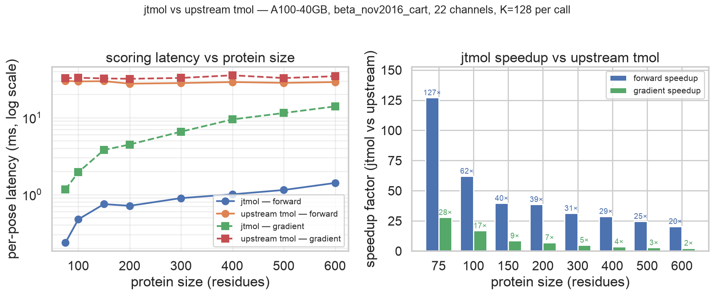

# Benchmarks

Throughput numbers for jtmol vs upstream tmol on A100. Full
methodology, interpretation, and parity caveats:
[`docs/EXPERIMENT_LOG.md`](EXPERIMENT_LOG.md).
Figure source: [`docs/figures/make_speedup_plot.py`](figures/make_speedup_plot.py).



## Single-GPU per-pose latency by protein size

A100-40GB, `beta_nov2016_cart` (22 channels), neighbor-list path on
LJLK + elec + lk_ball, K=128 perturbed poses per call. Precision:
float32 geometry, float64 accumulator. Repeats: 3, amortized after
one warmup.

| residues | atoms | jtmol fwd (ms/pose) | upstream fwd | speedup | jtmol grad | upstream grad | speedup |
|---:|---:|---:|---:|---:|---:|---:|---:|
|  75 | 1116 | 0.236 | 30.00 | **127×** |  1.159 | 32.40 | **28×** |
| 100 | 1591 | 0.474 | 29.46 |  62× |  1.943 | 32.87 | 17× |
| 150 | 2465 | 0.749 | 29.71 |  40× |  3.784 | 32.24 |  9× |
| 200 | 3039 | 0.712 | 27.56 |  39× |  4.462 | 31.88 |  7× |
| 300 | 4466 | 0.896 | 28.07 |  31× |  6.542 | 32.71 |  5× |
| 400 | 5899 | 1.004 | 28.94 |  29× |  9.448 | 35.39 |  4× |
| 500 | 7561 | 1.143 | 28.23 |  25× | 11.448 | 32.61 |  3× |
| 600 | 8800 | 1.411 | 28.91 | **20×** | 13.957 | 34.43 | **2×** |

Forward is measured under `torch.no_grad()` on the upstream side so
neither backend builds an autograd tape it discards — a fair
forward-vs-forward comparison. (This correction left the forward
speedups essentially unchanged: upstream forward is dispatch-bound, so
tape-building is negligible against kernel-launch overhead.)

Per-pose forward latency stays under 1.5 ms across an 8× range of
protein size. Upstream stays at ~30 ms because Python and PyTorch
op-dispatch overhead dominates the compute at every size tested. See
[`docs/EXPERIMENT_LOG.md`](EXPERIMENT_LOG.md) for the analysis.

## Batch size sweep at 1ubq

Same hardware, K varied at fixed protein (1ubq, 1231 atoms). Dense
path, `lax.map` chunking. jtmol's per-pose cost asymptotes near 1 ms;
upstream stays at ~30 ms regardless of K.

| K | jtmol fwd (ms/pose) | upstream fwd (loop) | speedup | jtmol grad | upstream grad | speedup |
|---:|---:|---:|---:|---:|---:|---:|
|    1 | 2.214 | 26.79 | 12× | 8.922 | 36.07 |  4× |
|    4 | 1.351 | 27.06 | 20× | 7.264 | 34.62 |  5× |
|   16 | 1.270 | 28.71 | 23× | 4.979 | 32.85 |  7× |
|   64 | 1.097 | 28.98 | 26× | 4.849 | 33.83 |  7× |
|  256 | 1.074 | 29.31 | 27× | 4.823 | 34.78 |  7× |
| 1024 | 1.072 | 30.22 | **28×** | 4.823 | 32.87 | **7×** |

## Multi-GPU scaling

2× A100-40GB, pmap across devices, K varied at fixed protein (1ubq).
Each device runs the chunked vmap; pmap shards K across devices and
joins at the end.

| K | 1-GPU (ms/pose) | 2-GPU (ms/pose) | speedup |
|---:|---:|---:|---:|
|   64 | 1.318 | 0.738 | 1.79× |
|  256 | 1.277 | 0.649 | 1.97× |
| 1024 | 1.270 | 0.638 | 1.99× |
| 4096 | 1.269 | 0.635 | **2.00×** |

Essentially perfect linear scaling above K=256. pmap overhead is
amortized away once each device has enough work.

## Wall-clock translation

Practical numbers that fall out of the table above.

| Task | jtmol | upstream tmol |
|---|---:|---:|
| Score 1024 1ubq-sized poses (forward) | **1.1 s** | 31 s |
| Score 4096 1ubq-sized poses (forward, 2-GPU) | **2.6 s** | ~123 s (extrap.) |
| Gradient through 64 200-residue binders | **0.29 s** | 2.2 s |
| Gradient through 64 600-residue complexes | **0.89 s** | 2.1 s |
| Hallucinate one binder (200 grad steps, 200-res complex) | ~0.9 s | ~6.8 s |

## Parity

The performance gap is for the same energy computation, not a cheaper
approximation. Cross-PDB parity at `atol=1e-5, rtol=1e-3` vs the live
upstream wheel:

* Forward: 88/100 cells PASS.
* Gradient: 72/100 cells PASS.
* All cells outside tolerance correspond to documented upstream-side
  bugs ([`docs/UPSTREAM_BUGS.md`](UPSTREAM_BUGS.md)).

On every channel where upstream is correct, jtmol matches to ~1e-5 in
float64. Per-cell detail in
[`docs/UPSTREAM_PARITY.md`](UPSTREAM_PARITY.md).

## How to reproduce

```bash
# Single-GPU sweep across protein sizes with NL on.
modal run examples/modal_bench_run.py::run_size_sweep --k 128 --nl

# Single-GPU sweep across K at fixed protein (1ubq).
modal run examples/modal_bench_run.py::run_bench --pdb 1ubq

# 2-GPU pmap sweep across K (requires A100:2 modal entitlement).
modal run examples/modal_bench_run.py::run_pmap --pdb 1ubq
```

Per-run raw outputs are in [`BENCHMARKS_SIZE.md`](BENCHMARKS_SIZE.md)
(dense path, with OOMs above 400 residues),
[`BENCHMARKS_SIZE_NL.md`](BENCHMARKS_SIZE_NL.md) (NL path, full sweep
75-600 residues), [`BENCHMARKS_PMAP.md`](BENCHMARKS_PMAP.md) (2-GPU
pmap).
