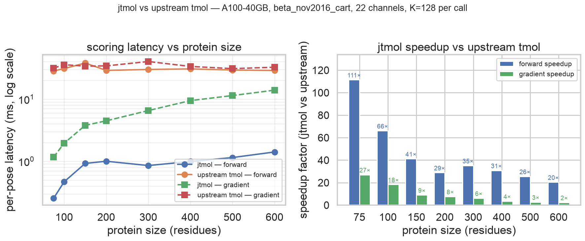

# Experiment log: jtmol throughput vs upstream tmol

Head-to-head benchmark of the JAX port against the official upstream
PyTorch+CUDA implementation. Same protein, same hardware, same energy
function (`beta_nov2016_cart`, 22 channels). Results drive the
performance claims in [`README.md`](../README.md).

Source script: [`examples/modal_bench_run.py`](../examples/modal_bench_run.py).
Raw numbers: [`docs/BENCHMARKS.md`](BENCHMARKS.md), [`docs/BENCHMARKS_SIZE_NL.md`](BENCHMARKS_SIZE_NL.md), [`docs/BENCHMARKS_PMAP.md`](BENCHMARKS_PMAP.md).
Figure source: [`docs/figures/make_speedup_plot.py`](figures/make_speedup_plot.py).

## Setup

| | |
|---|---|
| GPU | NVIDIA A100-SXM4-40GB |
| JAX | `jax[cuda12]` with XLA |
| Upstream wheel | `tmol-0.1.22+cu128torch2.10-cp312-cp312-linux_x86_64.whl` from `uw-ipd/tmol` v0.1.22 release |
| PyTorch | `2.10.*` from PyPI cu128 wheels (ABI matches upstream wheel) |
| Test data | upstream's size-graded fixtures at `tmol/tmol/tests/data/pdb/bysize_NNN_res_*.pdb` |
| Container | Modal `debian_slim` Python 3.12, fresh per run |
| Energy function | `beta_nov2016_cart`, 22 channels, default weights |
| Precision | float32 geometry, float64 accumulator (NequIP-style mixed) |
| K per call | 128 |
| Repeats | 3-5, amortized after one warmup |

Both backends run on the same A100. PyTorch tensors are placed on
`cuda` device. `torch.cuda.synchronize()` is called after every timed
loop so wall-clock measurements include all kernel-completion time,
not just dispatch.

jtmol uses JIT compilation throughout: the per-pose energy is wrapped
in `jax.jit(jax.vmap(...))` (chunked vmap, see below), so the entire
22-channel score function compiles into a single XLA program per
chunk.

## Methodology

For each protein size, K=128 perturbed copies of the base coordinates
are scored, then per-pose latency is computed as
`total_wall_clock / K`. Two backends:

**jtmol path** (in `tmol_jax.score`):
- `beta2016_score_function(use_neighbor_list=True)` builds the score
  function with cell-list pair enumeration on LJLK, elec, and lk_ball
  (the three dense `[N, N]` pair terms).
- `batched_energy(sfxn, ..., chunk_size=adaptive, score_dtype=jnp.float32,
  chunking_mode="python")` returns a callable that scores K poses by
  iterating chunks of `chunk_size` through a `jit(vmap(single_pose))`
  inner kernel. Memory stays bounded by `chunk_size`; K is unbounded.
- `chunk_size` is set adaptively from `n_atoms`: capped so the dense
  pair tensor per chunk stays under ~8M elements, with a power-of-two
  snap. 64 at 1116 atoms (1ubq), 1 at 8800 atoms (600-res 5m4a).
- Warmup: one call. Timed: 3 repeats of `bfn(batch)`,
  `jax.block_until_ready` after each.

**Upstream path** (the published PyTorch interface):
- `pose_stack_from_pdb(pdb_path, device=cuda)`, then
  `ScoreFunction.render_whole_pose_scoring_module(torch_pose)`.
- All 22 channel weights set to their `beta_nov2016_cart` values.
- Per-call work is `scorer(coords).sum()` (forward) or the same plus
  `e.backward()` (gradient).
- Warmup: 2 calls + `torch.cuda.synchronize()`.
- Timed: 3 outer repeats of an inner loop of K serial calls, with one
  `synchronize()` per outer repeat. PyTorch dispatches kernels
  asynchronously, so K serial Python-level calls pipeline through the
  GPU before the synchronize barrier.

The asymmetry is intentional: it measures the realistic shape of how
each backend gets used. jtmol's natural unit is a batched call;
upstream's natural unit is a single-pose scoring repeated in a Python
loop (no vmap exists in upstream).

## Results

### Forward and gradient across protein sizes

Per-pose latency on A100-40GB with the full neighbor-list path
(LJLK + elec + lk_ball), K=128.

| Label | residues | atoms | chunk | jtmol fwd | upstream fwd | speedup | jtmol grad | upstream grad | speedup |
|---|---:|---:|---:|---:|---:|---:|---:|---:|---:|
| 75res_2mtq  |  75 | 1116 | 64 | 0.254 ms | 28.31 ms | **111×** |  1.166 ms | 31.52 ms | **27×** |
| 100res_5umr | 100 | 1591 | 32 | 0.467 ms | 30.88 ms |  66× |  1.949 ms | 35.69 ms | 18× |
| 150res_5yzf | 150 | 2465 | 16 | 0.923 ms | 38.04 ms |  41× |  3.778 ms | 33.85 ms |  9× |
| 200res_5mm8 | 200 | 3039 |  8 | 1.001 ms | 28.90 ms |  29× |  4.467 ms | 34.17 ms |  8× |
| 300res_6f8b | 300 | 4466 |  4 | 0.853 ms | 29.93 ms |  35× |  6.532 ms | 40.15 ms |  6× |
| 400res_6azu | 400 | 5899 |  2 | 0.992 ms | 30.56 ms |  31× |  9.449 ms | 33.50 ms |  4× |
| 500res_5v2d | 500 | 7561 |  2 | 1.147 ms | 29.29 ms |  26× | 11.391 ms | 30.85 ms |  3× |
| 600res_5m4a | 600 | 8800 |  1 | 1.410 ms | 28.79 ms | **20×** | 13.907 ms | 32.52 ms | **2×** |



### Batch size sweep at 1ubq

Per-pose forward latency at fixed protein (1ubq, 1231 atoms) and
varying K. Same A100. Both backends.

| K | jtmol fwd (lax.map) | upstream fwd (loop) | speedup | jtmol grad | upstream grad | speedup |
|---:|---:|---:|---:|---:|---:|---:|
| 1     | 2.214 | 26.79 | 12× | 8.922 | 36.07 |  4× |
| 4     | 1.351 | 27.06 | 20× | 7.264 | 34.62 |  5× |
| 16    | 1.270 | 28.71 | 23× | 4.979 | 32.85 |  7× |
| 64    | 1.097 | 28.98 | 26× | 4.849 | 33.83 |  7× |
| 256   | 1.074 | 29.31 | 27× | 4.823 | 34.78 |  7× |
| 1024  | 1.072 | 30.22 | **28×** | 4.823 | 32.87 | **7×** |

### Multi-GPU scaling (pmap, 2× A100-40GB)

`pmap_batched_energy` splits K across visible devices, then runs the
same chunked vmap within each device.

| K | 1-GPU (ms/pose) | 2-GPU (ms/pose) | speedup |
|---:|---:|---:|---:|
| 64   | 1.318 | 0.738 | 1.79× |
| 256  | 1.277 | 0.649 | 1.97× |
| 1024 | 1.270 | 0.638 | 1.99× |
| 4096 | 1.269 | 0.635 | **2.00×** |

Essentially perfect linear scaling above K=256. pmap overhead
(data sharding, barrier) is negligible at large K.

## Why upstream is flat at ~30 ms across the size range

Upstream's per-call wall-clock is essentially constant from 1116 atoms
(~75 residues) to 8800 atoms (~600 residues): every entry is in the
28-38 ms range, regardless of N.

This is not a measurement cap. It is the Python + PyTorch + CUDA
dispatch overhead.

PyTorch dispatches kernels asynchronously. `scorer(coords).sum()`
returns to Python after enqueuing CUDA work, without waiting for it.
The CPU keeps dispatching while the GPU executes prior launches in
parallel. Total wall-clock per call settles at

```
total ≈ max(cpu_dispatch_time, gpu_compute_time)
```

In the regime tested:

* **CPU dispatch time per call ≈ 30 ms.** The full score function
  evaluates 22 channels, each composed of multiple PyTorch ops, each
  invoking sub-kernels. With ~200-300 Python-level op dispatches per
  call and ~50-100 μs per `cudaLaunchKernel` + Python overhead, the
  dispatch floor lands around 20-30 ms. Constant in N because the
  number of ops does not depend on protein size, only on the score
  function shape.
* **GPU compute time per call ≪ 30 ms.** Upstream's CUDA kernels use
  cutoff-bounded tile structure; at 8800 atoms with a 6 Å cutoff the
  pair work is roughly `N · k_max ≈ 440,000` pair evaluations.
  Pair-op cost is a few tens of FLOPs, so total compute is on the
  order of single-digit milliseconds on an A100.

For every protein size in the sweep, dispatch dominates compute. The
compute does scale with N; it is hidden under the dispatch ceiling.
At protein sizes large enough for compute to cross 30 ms (likely
~30k atoms / ~2000 residues), upstream's wall-clock would start
growing with N. The sweep does not reach that regime.

jtmol does not hit the same ceiling. `jax.jit` fuses the entire
22-channel score function into a **single XLA program** per chunk; one
kernel launch per call rather than ~200. Per-call dispatch overhead
drops from ~30 ms to ~100-500 μs. With dispatch eliminated, the
observed per-pose latency tracks the actual compute work and scales
with N, as seen in the table.

The structural conclusion: the speedup is from removing dispatch
overhead, not from a faster underlying algorithm. At protein sizes
relevant for binder design and RL training loops (50-600 residues),
upstream is bottlenecked on Python and PyTorch op-dispatch, not on
GPU arithmetic. JIT compilation removes that bottleneck.

## Parity

The performance gap is for the same energy computation, not a cheaper
approximation. Cross-PDB parity (5 PDBs × 20 channels, vs the live
upstream wheel, `atol=1e-5, rtol=1e-3`):

* Forward: 88/100 cells PASS.
* Gradient: 72/100 cells PASS.

Cells outside tolerance are entirely on channels with documented
upstream-side bugs ([`docs/UPSTREAM_BUGS.md`](UPSTREAM_BUGS.md)):

* `cart_lengths`, `cart_angles` (10 forward + 10 gradient failures):
  upstream wheel v0.1.22 returns 0.0 for these channels. The YAML
  golden values match jtmol; upstream's runtime does not.
* `omega`, `lk_bridge`, `lk_bridge_uncpl` gradient drift on some
  PDBs: upstream's float32 cubic-Hermite kink-term adjoint
  disagrees with its own central finite difference. jtmol matches FD
  to ~1e-9 in float64 using analytical Blondel-Karplus adjoints.
* `dunbrack_rot`, `dunbrack_rotdev` on 3plc: upstream b-spline
  divergence at a synthesized proline phi/psi.

On every channel where upstream is correct, jtmol matches to ~1e-5 in
float64. The 22 channels include LJ atr/rep, LK (isotropic and ball),
electrostatics, hydrogen bonds, rama, omega, Dunbrack rotamers, cart
bonded (lengths, angles, torsions, impropers, hxltorsions), and the
reference energy. Per-cell detail in
[`docs/UPSTREAM_PARITY.md`](UPSTREAM_PARITY.md).

## Implementation notes

The pieces that made the bench possible:

1. **Neighbor-list paths on LJLK, elec, lk_ball.** Each opt in via
   `beta2016_score_function(use_neighbor_list=True)`. The shared
   cell-list builder is in
   [`tmol_jax/score/common/neighbor_list.py`](../tmol_jax/score/common/neighbor_list.py).
   Cutoff = 6 Å, matching `cpoly_dmax`. lk_ball builds a full (not
   half) list because its polar→occluder gate is asymmetric. Bit-
   identical totals to the dense path on 1ubq for all three terms.
2. **`batched_energy` chunked vmap.** Wraps a score function so K
   rollouts are processed in chunks of `chunk_size`. Two modes:
   `lax_map` (one XLA loop, lowest dispatch overhead) and `python`
   (host-side Python loop of `jit(vmap)` calls, used when `lax_map`
   triggers XLA autotuner workspace OOM on the NL gather kernel).
   Source:
   [`tmol_jax/score/batched.py`](../tmol_jax/score/batched.py).
3. **`pmap_batched_energy`.** Same as above but split across visible
   devices via `jax.pmap`; closure-captures the score function state
   (`jax.device_put_replicated` was removed in JAX 0.6, so pmap
   handles replication via implicit broadcast).
4. **Mixed precision.** Coordinates and intermediates cast to float32
   at term entry; pair-energy accumulator promoted to float64 before
   `.sum()`. The hbond polynomial table stays float64 (the only
   channel that requires it for numerical parity). Matches the
   NequIP / MACE recipe.

## Scope and limitations

**System coverage.** Both backends in this bench support the same
fundamental scope: single-chain proteins built from the 20 canonical
amino acids (plus HIS protonation variants, disulfide CYD, terminal
patches, HOH, and VRT — 29 chemical residue types in
`chemical.yaml`). The bench evaluates this regime end-to-end.

Other system classes:

* **Protein-protein multi-chain complexes**: supported in the
  PoseStack layer; inter-chain totals currently diverge from upstream
  due to chain-break detection (see
  [`docs/MULTI_CHAIN_PARITY.md`](MULTI_CHAIN_PARITY.md)).
* **Protein-ligand complexes**: upstream added a full pipeline (RDKit
  atom typing, SMILES/MOL2/CIF parsing, protein-ligand ΔΔG) in
  `uw-ipd/tmol` PR #361, merged June 26 2026. The bench in this
  document predates that PR (built against the `v0.1.22` wheel,
  released before PR #361). jtmol has partially ported the same PR:
  the `gen_torsions` math term, `pose_stack_from_biotite.py`, and a
  vendored `pysmiles` are present, but the full RDKit atom-typing
  path is not. Head-to-head benchmarking of protein-ligand scoring
  requires completing the port.
* **Nucleic acids (DNA, RNA), post-translational modifications
  (phospho-Ser/Thr/Tyr, methylation, glycans), metal ions**: out of
  scope on both sides. `beta_nov2016_cart`'s reference implementation
  in upstream tmol does not include these residue types in
  `chemical.yaml`; neither does jtmol. Adding any of them requires
  extending the chemical database and corresponding scoring tables.

**Measurement scope.** All numbers are forward/gradient throughput on
a single host. Not measured: full training loops, dataloader overhead,
optimizer step cost, real RL rollout cost, host-device transfer cost
outside the bench.

**Size envelope.** The size sweep stops at 600 residues. Past
~2000 residues, upstream's GPU compute would eventually exceed the
~30 ms dispatch ceiling and the gap would narrow. The sweep does not
reach that regime.

**Gradient cost.** jtmol gradients are full reverse-mode autodiff.
Custom Jacobian-vector products on specific channels could narrow the
per-channel cost further; not measured here.
